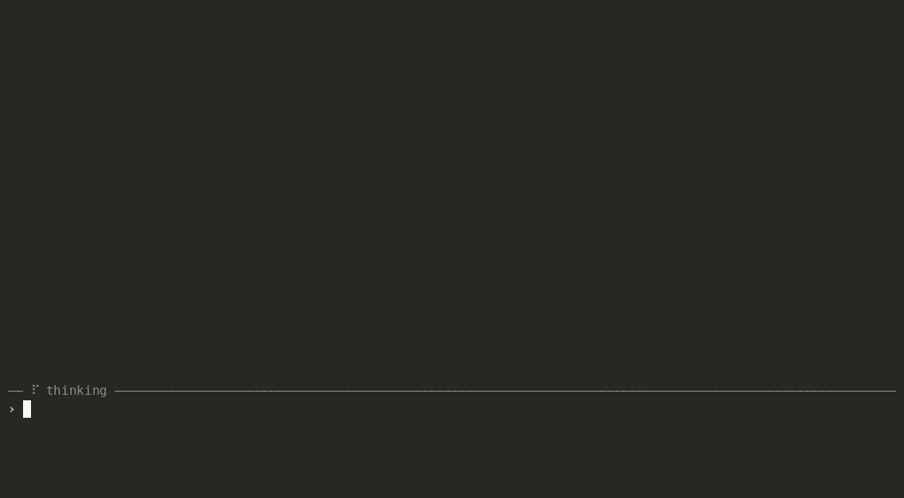

# lean-coder

A small terminal coding agent: stdlib-only Python core, minimal context overhead.



<!-- overhead-gate: tests/_smoketest.py reads these two numbers; they are the pass/fail limits -->
| Surface | Max tokens |
|---|---|
| Always-on (core tools) | 2500 |
| Every bundled lean-tool enabled | 6500 |

## Install

Requires Python 3.11+ and `curl` or `git`.

```bash
curl -fsSL https://raw.githubusercontent.com/codemonkeying/lean-coder/main/install.sh | bash
```

Android / Termux:

```bash
pkg install -y python curl && curl -fsSL https://raw.githubusercontent.com/codemonkeying/lean-coder/main/install.sh | bash
```

Options: `--with-ollama --pull` (local Ollama on Linux), `--dry-run`. The installer adds
`~/.local/bin` to PATH in your shell rc if it isn't there. Update with `lean_coder --update`
or `/update`.

Uninstall: `~/lean-coder/uninstall.sh` (or `./uninstall.sh` in a clone) lists what it will
remove and asks first. By default that includes `~/.config/leancoder` - settings, sessions and
auth tokens; pass `--keep-config` to keep them. `install.sh --uninstall` does the same with
`--keep-config`.

From a clone:

```bash
git clone https://github.com/codemonkeying/lean-coder
cd lean-coder && python3 lean_coder.py
```

## Quick start

```bash
lean_coder                                  # start in the current project
lean_coder --host http://HOST:11434         # remote Ollama
```

Inside: `/provider` picks a backend, `/model` a model, `/leash` and `/approve` set
tool access and confirmation, `/connect` works on a remote box over SSH, `/help` lists
everything. Config lives in `~/.config/leancoder/config.toml`.

## Reference

- [doc/COMMANDS.md](doc/COMMANDS.md) - slash-command contract and leash tiers
- [doc/LEAN_TOOLS.md](doc/LEAN_TOOLS.md) - writing lean-tools
- [doc/PROVIDER_API.md](doc/PROVIDER_API.md) - writing model providers
- [doc/MCP.md](doc/MCP.md) - MCP servers
- [doc/WORKERS.md](doc/WORKERS.md) - background workers and task boards
- [CONTRIBUTING.md](CONTRIBUTING.md) - test gates

## License

Copyright (c) 2026 codemonkeying. All rights reserved.

No licence is granted to use, copy, modify or distribute this software. Releases up to
and including 0.10.103 were published under MIT, and 0.10.104 to 0.10.124 under Apache-2.0;
copies of those releases keep those licences.
